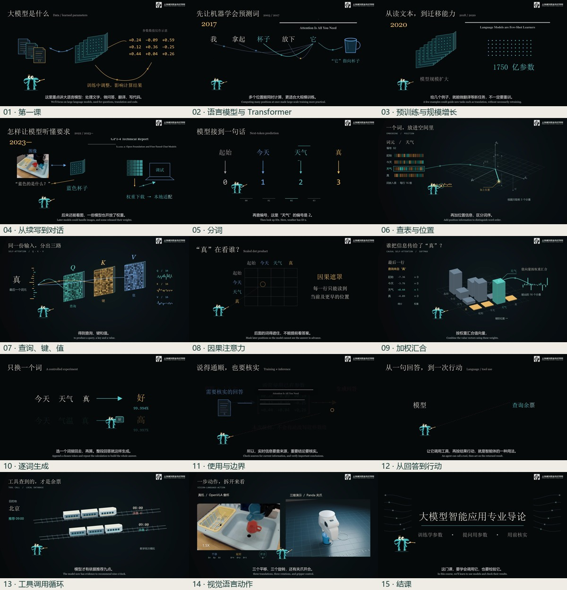

# 中文教学动画与可复用制作工作台

把技术文案、素材查找、男声配音、双语字幕、Manim 动画、三维演示和逐帧合成组织为可修改的本地流程。2026 年 10—11 月，围绕 ResNet 残差连接、大模型导论及人工智能基础持续迭代。

## 已完成

- 最新基准：大模型智能应用导论第一课，195.10 秒、1920×1080/30fps、15 个场景、56 句双语字幕。
- 定义、历史、训练、注意力计算、生成、核验来源、工具调用与 VLA 连成一条讲解主线。
- Manim Community 负责讲解图形；Cairo/PyAV 负责逐帧空间演示与 Π 角色；Blender 预渲染负责 Panda 机械臂教学画面；FFmpeg 合成和混音。
- 本地编辑网页与命令行支持改稿、逐步渲染、日志和预览；2 个原创流程 skill、3 个冻结版本的开源 skill、8 份分环节指南。
- 从独立目录、全新虚拟环境重建，5853 帧全片解码通过，空白帧 0；与基准缩放至 640×360 后的 SSIM 为 0.998628。它衡量画面相似性，不是自动教学评分。

技术画面的数值来自受控 16 维教学解码器，不能当作商用模型内部数值。机械臂关键帧模拟与 OpenVLA 真机实验录像分别标明。

完整工程和视频 Release 保存在作者的私有 `teaching-video-workbench` 仓库；这里展示制作方法与成果概览。项目使用 [Manim Community](https://github.com/ManimCommunity/manim)、[OpenVLA](https://openvla.github.io/) 公开实验资料与有归属记录的 Panda 网格；学校标识沿用课程资产。
